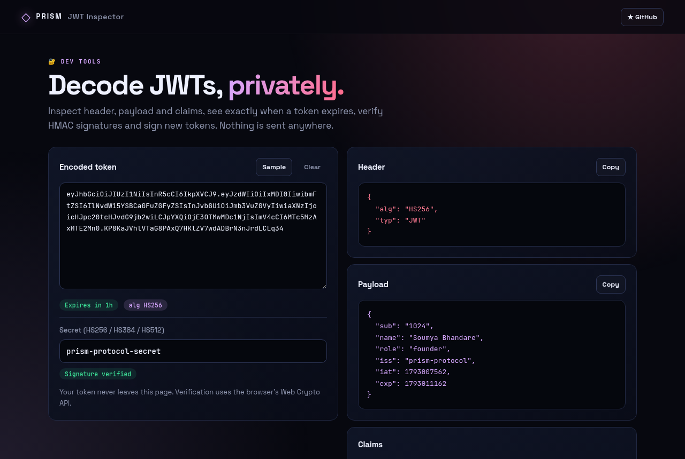
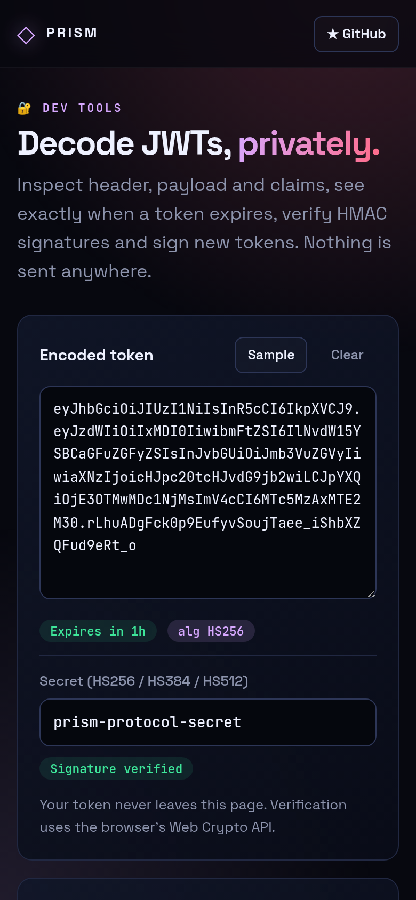

<!-- ═════════════ HEADER ═════════════ -->
<p align="center">
  
</p>

<p align="center">
  
</p>

<p align="center">
  <a href="https://github.com/krishyaa06/prism-jwt-inspector/actions/workflows/ci.yml"></a>
  <a href="https://krishyaa06.github.io/prism-jwt-inspector/"></a>
  
  
  <a href="LICENSE"></a>
</p>

<p align="center">
  
</p>


## ⚡ Overview

**Prism JWT Inspector** is a private alternative to pasting production tokens into random websites. It decodes the header and payload, lists every claim with human-readable dates, shows whether the token is valid, expired or not yet active, and verifies HMAC signatures using the browser's Web Crypto API. You can also sign new test tokens.

## ✨ Features

- **Instant decode** of header and payload (accepts `Bearer ...` too)
- **Expiry status**: valid, expired or not-yet-valid with countdown
- **Claims table** with labels and local dates for `exp`, `iat`, `nbf`
- **Signature verification** for HS256, HS384 and HS512
- **Token creator** with payload editor and expiry presets
- Runs offline, no network requests, no analytics

## 📸 Screenshots

<table>
  <tr>
    <td width="68%"></td>
    <td width="32%"></td>
  </tr>
</table>

## 🚀 Quick Start

**Use it online:** [https://krishyaa06.github.io/prism-jwt-inspector/](https://krishyaa06.github.io/prism-jwt-inspector/)

**Run locally:**

```bash
git clone https://github.com/krishyaa06/prism-jwt-inspector.git
cd prism-jwt-inspector
# open index.html in your browser, or serve it:
npx serve .
```

## 🛠️ Usage

1. Paste a token in **Encoded token**.
2. Read the header, payload and claims on the right.
3. Enter the secret to verify an HMAC signature.
4. Use **Create a token** to sign test JWTs for local development.

> RS256/ES256 tokens can be decoded but not verified, since that needs the public key.

## 📁 Project Structure

```
prism-jwt-inspector/
├── assets/
│   ├── logo.png
│   └── logo.svg
├── css/
│   ├── app.css
│   └── prism.css
├── js/
│   ├── app.js   # UI wiring
│   ├── core.js   # decode, verify and sign via Web Crypto — tested in Node
│   └── prism.js
├── test/
│   └── core.test.js
├── .gitignore
├── LICENSE
├── README.md
├── index.html
└── package.json
```

## 🧪 Tests

```bash
npm test
```

Tests use the built-in `node:test` runner, so there is nothing to install. CI runs them on Node 20 and 22.

## 🤝 Contributing

1. Fork the repo and create a branch: `git checkout -b feature/my-idea`
2. Make your change and add a test in `test/`
3. Run `npm test` and open a Pull Request

## 🔷 Part of Prism Protocol

Prism JWT Inspector is one of the open-source tools built by [Prism Protocol](https://dc.gg/prismprotocol), a tech community where young builders learn, ship and compete together.

## 👤 Author

<table>
  <tr>
    <td align="center">
      <a href="https://github.com/krishyaa06"><br><b>Soumya Bhandare</b></a><br>
      <sub>Founder @ Prism Protocol</sub>
    </td>
    <td>
      <a href="https://dc.gg/prismprotocol"></a><br>
      <a href="https://instagram.com/prism_protocol_"></a><br>
      <a href="https://x.com/krishyaa06"></a>
    </td>
  </tr>
</table>

## 📄 License

Released under the [MIT License](LICENSE).

<p align="center">
  <b>If you like this project, consider giving it a ⭐</b><br>
  <sub>"Build. Create. Compete." · Made with ⚡ by Prism Protocol</sub>
</p>


